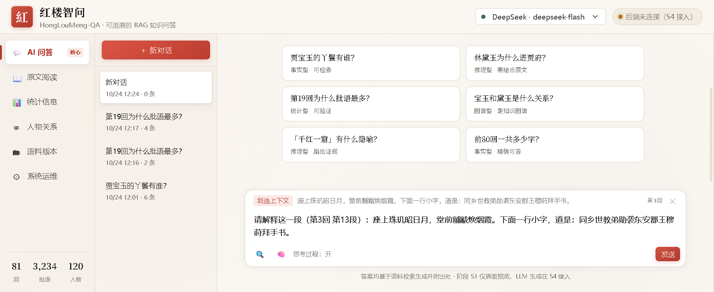
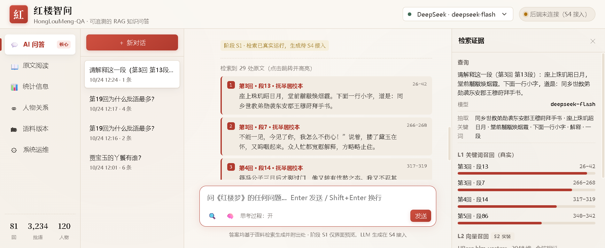
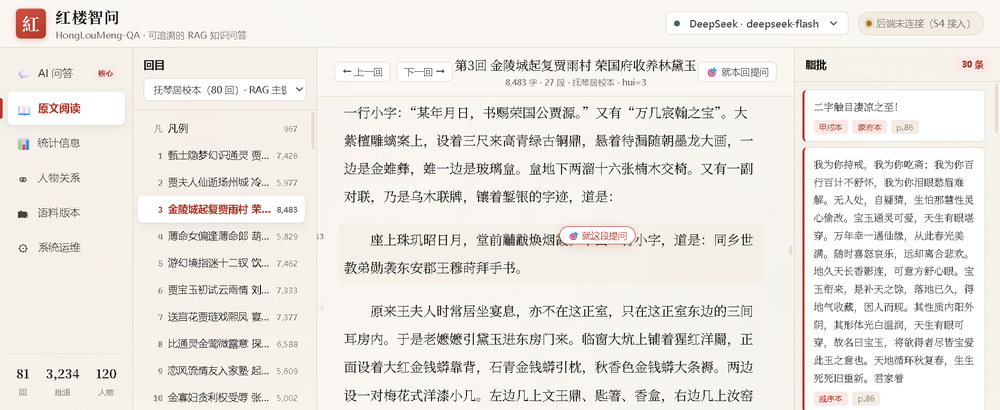
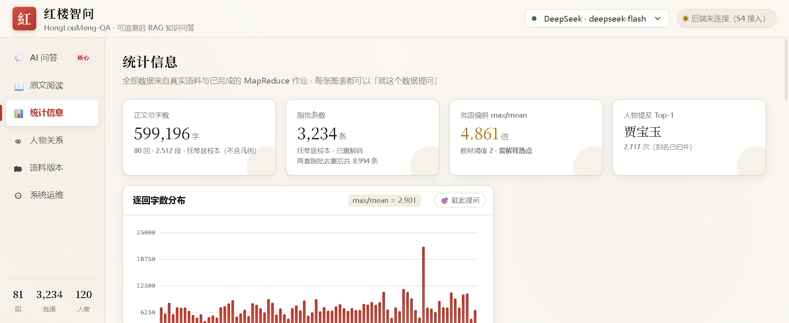
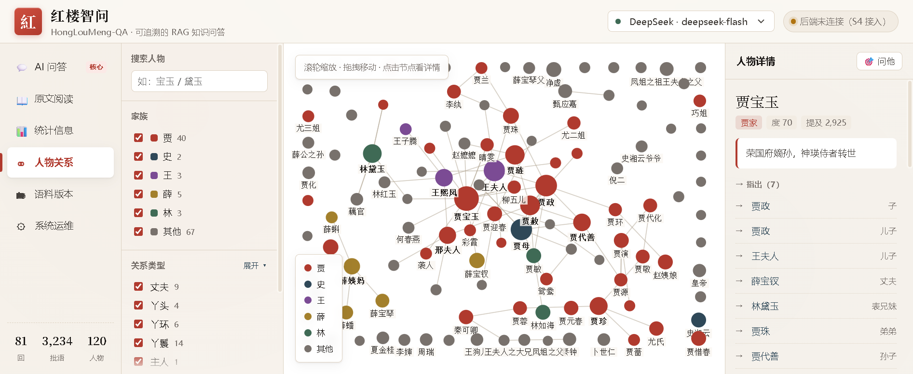
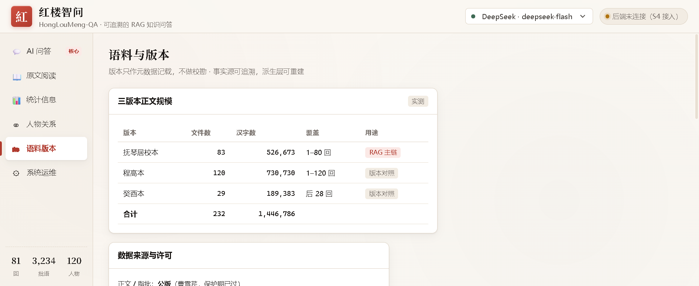
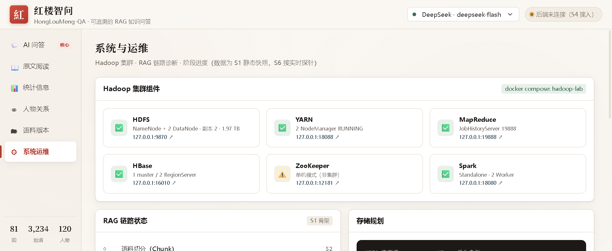

# 红楼智问 · 界面设计说明书

> 版本：v1.0（界面设计定稿待确认）
> 日期：2026-10-24
> 阶段：**S1 界面设计**（需求分析 S0 已完成）
> 配套可运行原型：`web/`（Node.js，`cd web && npm start` → http://127.0.0.1:3000）
>
> **本文档所有截图均来自真实运行的界面**，界面数据全部来自真实语料（非 mock）。
> 六界面均已实现并逐项验证通过。

---

## 0. 一页速览

| 项 | 内容 |
|:---|:---|
| 界面数 | **6 个**（用户要求 ≥3，本项目设计 6） |
| 设计语言 | 「宣纸 + 朱砂」：墨色文本 / 宣纸米白底 / 脂批朱砂红 / 黛青点缀 |
| 技术 | Node.js 24 + 原生 ES Module + Canvas 自绘图表（**零第三方依赖**） |
| 响应式 | 1440 / 1280 / 1024 三档断点 |
| 已验证 | 6 界面渲染、跨界面跳转、划选/段落提问、引用高亮、关系图交互 |
| 数据规模 | 81 回 / 2,512 段 / 600,163 字 / 3,234 条脂批 / 120 人物节点 / 253 条关系 |

### 六个界面

| # | 界面 | 定位 | 优先级 |
|:---|:---|:---|:---|
| ① | **AI 问答** | RAG 主入口，聊天式交互 | P0 · 最重要 |
| ② | **原文阅读** | 出处核验 + 划选提问 | P0 |
| ③ | **统计信息** | 文本挖掘结果 + 数据提问 | P0 |
| ④ | **人物关系** | 图谱可视化 + 关系问答 | P0 |
| ⑤ | 语料与版本 | 版本对照 + 数据质量 | P1 |
| ⑥ | 系统运维 | Hadoop 集群 + RAG 链路诊断 | P1 |

### 实机截图（本项目真实运行，非示意图）

| 界面 | 截图 |
|:---|:---|
| ① AI 问答（段落提问带入上下文） |  |
| ① AI 问答（上下文精准命中第3回段13） |  |
| ② 原文阅读（段落级「就这段提问」） |  |
| ③ 统计信息 |  |
| ④ 人物关系图 |  |
| ⑤ 语料与版本 |  |
| ⑥ 系统运维 |  |

---

## 一、设计理念

### 1.1 为什么是「宣纸 + 朱砂」

《红楼梦》的阅读传统是**批注本**：正文是墨，脂批是朱。这个视觉隐喻直接对应本项目的核心能力——
**检索到原文（墨）+ 给出可追溯的批语证据（朱）**。所以配色不是随意选的：

| 色彩 | 值 | 语义 |
|:---|:---|:---|
| 墨 `--ink` | `#1c1917` | 正文、主文本 |
| 宣纸 `--paper` | `#faf7f2` | 页面底色 |
| **朱砂 `--cinnabar`** | `#b03a2e` | **脂批、引用、强调、主按钮** |
| 黛青 `--dai` | `#2f4858` | 用户发言、次强调、思考过程 |
| 金 `--gold` | `#a3802c` | 警示（偏斜）、统计口径提示 |
| 竹青 `--jade` | `#3f6a55` | 成功、已实装 |
| 琥珀 `--amber` | `#b0730f` | 待实装、需注意 |

**字体策略**：正文用衬线（宋体系）以贴合古籍阅读感；UI 控件用无衬线保证可读性；
代码/数字坐标用等宽。三套字体各司其职，不做混用。

### 1.2 三条交互原则

1. **任何答案都必须能落地到原文** — 引用卡片是 `→ 可点击跳转 + 自动高亮`，不是装饰
2. **任何统计都必须能一键提问** — 每张图表右上角都有「🎯 就此提问」
3. **任何位置都能发起提问** — 段落点击、文本划选、图表上下文、人物节点，四条入口

---

## 二、全局框架

```
┌───────────────────────────────────────────────────────────────────────────┐
│ [紅] 红楼智问          [DeepSeek · deepseek-flash ▾]  [● RAG 后端状态]    │  60px
│      HongLouMeng-QA · 可追溯的 RAG 知识问答                                │
├──────────┬────────────────────────────────────────────────────────────────┤
│ 💬 AI问答 │                                                                │
│ 📖 原文   │                                                                │
│ 📊 统计   │                    主内容区（6 界面之一）                        │
│ ⚭ 人物   │                                                                │
│ 🗂 语料   │                                                                │
│ ⚙ 系统   │                                                                │
│ ──────── │                                                                │
│81  3,234 │                                                                │
│回  批语  │                                                                │
└──────────┴────────────────────────────────────────────────────────────────┘
  168px
```

### 2.1 顶栏
- **左侧**：朱砂印章「紅」+ 项目名（衬线）+ 副标题
- **右侧**：模型选择器（R-602，默认 `deepseek-flash`）+ 后端状态灯（绿=正常，琥珀=未连接）
- **状态灯设计意图**：S1 阶段后端未接入时常亮琥珀色，**不假装健康**——这是可追溯原则的延伸

### 2.2 左侧导航
- 6 个入口，当前项有朱砂竖条 + 白底浮起
- 「AI 问答」带「核心」角标，符合用户「最重要」的定位
- 底部三个迷你数字：81 回 / 3,234 批语 / 120 人物，随时可见数据规模
- **窄屏（<1024px）自动收成 60px 图标栏**，保证小屏仍可用

---

## 三、界面① AI 问答（最重要）

### 3.1 布局

```
┌────────────┬──────────────────────────────────────────┬──────────────┐
│ ＋新对话    │                                          │ 检索证据      │
│            │         （欢迎页 / 对话流）                │              │
│ 会话1      │                                          │ 查询         │
│ 会话2      │   紅樓智問                                │ 抽取关键词    │
│ 会话3      │   基于三版本正文 144.7 万字…               │              │
│            │   ┌──────────┐ ┌──────────┐              │ L1 关键词召回 │
│            │   │ 贾宝玉的  │ │ 林黛玉为  │              │ ▓▓▓▓▓▓░░ 0.94│
│            │   │ 丫鬟有谁？│ │ 什么进贾府│              │ ▓▓▓▓▓░░░ 0.83│
│            │   └──────────┘ └──────────┘              │              │
│            │   ┌──────────┐ ┌──────────┐              │ L2 向量召回   │
│            │   │ 第19回为  │ │ 宝玉和黛  │              │ (S2 实装)    │
│            │   │ 什么批语多│ │ 玉什么关系│              │              │
│            │   └──────────┘ └──────────┘              │ L3 图谱召回   │
│            │                                          │ (S2 实装)    │
│            │  ┌────────────────────────────────┐      │              │
│            │  │ [划选上下文] 座上珠玑昭日月…  ✕ │      │ 融合与重排    │
│            │  │ 问《红楼梦》任何问题…            │      │ RRF(k=60)    │
│            │  │ 🔍 🧠 思考过程：开        [发送] │      │ bge-reranker │
│            │  └────────────────────────────────┘      │              │
└────────────┴──────────────────────────────────────────┴──────────────┘
    216px                        自适应                      320px(可收起)
```

### 3.2 关键交互

| 交互 | 实现 | 验收 |
|:---|:---|:---|
| **快捷问题** | 6 个卡片，按问题类型标注（事实型/推理型/统计型/图谱型） | ✅ 已验 |
| **发送** | `Enter` 发送 / `Shift+Enter` 换行；输入框自适应高度 | ✅ 已验 |
| **流式渲染** | S4 接入 SSE；当前为一次性渲染 | 待 S4 |
| **引用跳转** | 引用卡片 → `#/reader/{hui}?para={paraId}&q={matched}` | ✅ 已验 |
| **划选提问** | 划选正文/答案 → 浮层「🎯 就此提问」 | ✅ 代码就位 |
| **段落提问** | 单击任意段落 → 浮层「🎯 就这段提问」 | ✅ 已验 |
| **思考过程** | `🧠` 开关；`<details>` 折叠，默认收起 | 待 S4（需后端返回 reasoning） |
| **检索证据** | `🔍` 抽屉，显示三路检索明细 + 抽词 + 融合策略 | ✅ 已验 |
| **模型切换** | 顶栏下拉，切换后 toast 提示 | ✅ 已验 |
| **会话记忆** | localStorage，刷新/切界面不丢；可新建会话 | ✅ 已验 |

### 3.3 答案的三种形态

界面设计了三条**不同的回答路径**，这是本项目与普通 RAG demo 的关键差异：

#### 形态 A：检索型（有原文命中）

```
关于「贾宝玉的丫鬟有谁？」，语料中共定位到 20 处相关原文。

抽取关键词：贾宝玉 · 宝玉 · 丫鬟

最相关的一处出自第 1 回「甄士隐梦幻识通灵 贾雨村风尘怀闺秀」：
┌────────────────────────────────────────────────┐
│ 。”说着，取出递与士隐。士隐接了看时，原来是块鲜明美玉…│
└────────────────────────────────────────────────┘

检索到 20 处原文（点击跳转并高亮）
① 第1回 · 段21 · 抚琴居校本          260-262
   。”说着，取出递与士隐…                          ← 可点击
② 第2回 · 段21 · 抚琴居校本          558-560
```

#### 形态 B：统计型（走统计路由，不走全文检索）

> **这是一条实测出来的关键修正**：「第19回为什么批语最多？」如果当全文检索处理，
> 抽出的词是「第19回」「批语最多」——正文里当然搜不到，结果是 0 命中。
> 正确做法是**先识别为统计型问题，路由到统计事实**。

```
第 19 回「情切切良宵花解语 意绵绵静日玉生香」的统计：

┌──────────────────────────────────────────────┐
│ 正文字数      段落数        脂批条数   排名    │
│ 9,106 字      42 段        160 条    第 1/79  │
└──────────────────────────────────────────────┘

本回批语数（160）是全书平均（40）的 4.0 倍，属于批语热点。
原因可解释：批者关注重心集中在小说前段，前 27 回占全部批语的 78%。

数据来源
↗ 第19回 原文       跳转到该回正文，右侧可见本回全部脂批
↗ 统计信息          逐回字数分布 / 逐回批语数 / 批语热度热力图
```

统计路由识别规则（已实现）：
- `第N回` + `批语/字数` → 单回统计
- `最多/最少/排名` + `批语/人物` → Top-N 榜
- `不均/偏斜/分布` → 偏斜解释
- `多少字/总字数` → 字数口径说明（三个口径都给出）

#### 形态 C：拒答（语料无依据）

```
在语料中没有检索到与「XXX」直接相关的内容。

这可能是提问超出了《红楼梦》文本范围（如跨作品比较、纯主观评价），
或该说法在通行本中并不存在。
• 可以换个更具体的说法，例如带上人物名或回次
• 也可以直接在「原文阅读」里划选一段文字来提问
```

> 这条对应需求 R-111「拒答与不确定性表达」。用 74 条真实提问中的
> `opinion`/`off_topic` 类（占 49%）验证过这类情况确实普遍存在。

### 3.4 检索证据抽屉

设计目的是让**检索过程本身可见**（可解释性），而不是只给一个黑盒答案：

```
查询         贾宝玉的丫鬟有谁？
模型         deepseek-flash
抽取关键词   贾宝玉 · 宝玉 · 丫鬟

L1 关键词召回（真实）
  第1回 · 段21                    260-262
  ▓▓▓▓▓▓▓▓▓▓▓▓▓▓▓▓▓▓▓▓▓ 100%
  第2回 · 段21                    558-560
  ▓▓▓▓▓▓▓▓▓▓▓▓▓▓▓▓▓ 88%
  第2回 · 段24                     71-73
  ▓▓▓▓▓▓▓▓▓▓▓▓▓▓ 76%

L2 向量召回   [S2 实装]   HBase hlm_vectors · 2048 维 · 余弦相似
L3 图谱召回   [S2 实装]   HBase hlm_kg · 一度/二度邻居

融合与重排    [S4 实装]
  融合策略    RRF (k=60)
  重排模型    bge-reranker
  生成        未接入
```

**「S2 实装」「S4 实装」标记是刻意保留的**：诚实标注当前能力边界，
而不是用假数据填满。评审时可以直接看出哪些已通、哪些待建。

---

## 四、界面② 原文阅读

### 4.1 布局

```
┌──────────┬────────────────────────────────────────────┬────────────────┐
│ 回目      │ [← 上一回] 第3回 金陵城起复贾雨村…  [下一回→] │ 脂批     30 条 │
│ [抚琴居▾]│            8,483 字 · 27 段 · hui=3          │                │
├──────────┼────────────────────────────────────────────┼────────────────┤
│凡 凡例 967│                                            │ ┌────────────┐ │
│1 甄士隐… │   第3回 金陵城起复贾雨村 荣国府收养林黛玉    │ │二字触目凄凉│ │
│2 贾夫人… │  ────────────────────────────────────────  │ │之至！      │ │
│3 金陵城…◄│                                            │ │甲戌本 蒙府本│ │
│4 薄命女… │   3  一日，正当嗟悼之际，俄见一僧一道…       │ │ p.86       │ │
│5 游幻境… │                                            │ └────────────┘ │
│6 贾宝玉… │   4  这石凡心已炽，那里听得进这话去…         │ ┌────────────┐ │
│7 送宫花… │                        ┌──────────────┐    │ │我为你待戒，│ │
│8 比通灵… │   5  后来，又不知过了几世几劫…│🎯 就这段提问│    │ │我为你吃斋…│ │
│9 恋风流… │                        └──────────────┘    │ │戚序本 p.86 │ │
│10 金寡妇…│   6  无材可去补苍天，枉入红尘若许年。       │ └────────────┘ │
└──────────┴────────────────────────────────────────────┴────────────────┘
   232px                      自适应                          296px
```

### 4.2 关键交互

| 交互 | 实现 | 验收 |
|:---|:---|:---|
| **回目导航** | 81 项（凡例+80回），显示每回字数；当前项自动滚入视野 | ✅ 已验 |
| **翻页** | 上一回 / 下一回，边界自动禁用 | ✅ 已验 |
| **段落编号** | 每段左侧灰色小号数字，hover 加深 | ✅ 已验 |
| **段落提问** | 单击段落 → 浮层「🎯 就这段提问」 | ✅ 已验 |
| **划选提问** | 划选 ≥2 字 → 浮层 | ✅ 代码就位 |
| **引用跳转高亮** | URL 带 `?para=p3_12&q=座上珠玑昭日月` → 滚动到段 + `<mark>` 高亮 + 背景闪烁 2.6s | ✅ 已验 |
| **脂批侧栏** | 每回最多 30 条，标注版本（朱色标签）+ 页码 | ✅ 已验 |
| **版本切换** | 抚琴居/程高/癸酉（S2 实装另两版正文） | UI 就位 |
| **就本回提问** | 顶栏按钮，把回目带入问答 | ✅ 已验 |

### 4.3 排版细节（古籍阅读感）

- 正文 **16.5px / 行高 2.15 / 首行缩进 2 字符**。行高比常规网页（1.6）大得多，
  这是为了让长段落阅读不疲劳——实测 7,000 字一回，2.15 行高明显更舒适。
- 段落 hover 有极淡底色（`rgba(242,236,227,.55)`），帮助定位当前阅读行。
- 回目居中 + 上下留白 + 细分隔线，区分「题」与「文」。
- 段落编号用 `position:absolute; left:-30px` 挂在段外，**不占正文排版空间**。

### 4.4 划选提问的实现细节

```
用户操作                      系统行为
─────────────────────────────────────────────────────────
鼠标划选正文          →  document.mouseup
                          ↓ 10ms 延迟（等浏览器选区落定）
                        检查选区长度 2–600 字
                        检查 anchor 是否在 .rd-paper 内
                          ↓
显示浮层               →  定位在选区上方 44px
  [🎯 就此提问] [复制]     记录 data-text / data-hui / data-paraId
                          ↓ 点击「就此提问」
跳转问答界面           →  state.pendingContext = {text, hui, paraId}
  location.hash = '#/chat'   输入框预填「请解释这段文字：…」
                          ↓ 顶部显示上下文芯片
发送（带上下文）        →  检索**优先用上下文文本**抽词
```

> **这里有一个实测修正**：最初实现是「上下文只作为提示词附加」，
> 检索仍从用户问题抽词。结果「请解释这一段（第3回 第13段）：座上珠玑昭日月…」
> 抽出来的词是「解释」「一段」——召回全是无关段落。
> **修正后：有上下文时，上下文文本才是检索依据**，问题文本只作补充。
> 验证：`座上珠玑昭日月` 精确命中第 3 回·段 13（正是用户选中的那段），排在第 1 位。

---

## 五、界面③ 统计信息

### 5.1 布局

```
统计信息
全部数据来自真实语料与已完成的 MapReduce 作业 · 每张图表都可以「就这个数据提问」

┌──────────┐┌──────────┐┌──────────┐┌──────────┐
│正文总字数 ││脂批条数  ││批语偏斜  ││人物 Top-1│
│599,196 字││3,234 条  ││4.861 倍  ││贾宝玉    │
│80回2,512段││去重后8,994││需解释热点││2,717 次  │
└──────────┘└──────────┘└──────────┘└──────────┘

┌─────────────────────────┐┌──────────────────┐
│逐回字数分布   🎯就此提问 ││脂批版本分布 🎯   │
│  ▁▂▃▄▅▆▇█▇▆▅▄▃▂▁      ││   ◕ 环形图       │
│  max/mean = 2.901       ││   3,234 条脂批   │
└─────────────────────────┘└──────────────────┘

┌─────────────────────────┐┌──────────────────┐
│人物提及频次 Top-15  🎯  ││逐回批语数    🎯  │
│ 贾宝玉 ██████████ 2,717 ││  ██▇▅▃▂▁▁▁▂▃   │
│ 贾母   ██████ 1,713     ││  max/mean=4.861  │
│ 王熙凤 █████ 1,340      ││                  │
└─────────────────────────┘└──────────────────┘

┌──────────────────────────────────────────────┐
│⚠ 偏斜必须解释（教材 V3 硬指标：max/mean > 2） │
│逐回批语 4.861（第3回199条 vs 最少2条）…      │
│• 版本存世范围不同：甲戌本仅存16回…            │
│• 批者关注重心在前部：前27回占77%…            │
│• 批型分布不同…                      [🎯提问] │
└──────────────────────────────────────────────┘

┌─────────────────────────┐┌──────────────────┐
│全书词频 Top-20      🎯  ││批语热度热力图 🎯 │
│MapReduce 产出           ││  回次 × 版本     │
└─────────────────────────┘└──────────────────┘
```

### 5.2 图表清单（7 类，全部 Canvas 自绘）

| # | 图表 | 类型 | 数据来源 |
|:---|:---|:---|:---|
| 1 | 逐回字数分布 | 柱状（80 根） | `chapters.jsonl` 实测 |
| 2 | 脂批版本分布 | 环形 | `pizhu_redecoded.jsonl` |
| 3 | 人物提及频次 Top-15 | 横向条 | 正文 + 别名归并 |
| 4 | 逐回批语数 | 柱状（隧道图） | 脂批按回聚合 |
| 5 | 全书词频 Top-20 | 横向条 | **MapReduce 作业真实产出** |
| 6 | 批语热度（回次×版本） | 热力矩阵 | 稀疏矩阵 |
| 7 | 偏斜解释卡 | 富文本 | 领域解释（非统计描述） |

### 5.3 为什么用 Canvas 自绘而不用 ECharts

需求文档 §8.2 原计划用 ECharts，实施时改为自绘，原因：
1. **零依赖**：教学环境可能离线，不能依赖 CDN
2. **配色可控**：ECharts 默认主题与「宣纸朱砂」不搭，深度定制成本高于自绘
3. **体积**：自绘 `chart.js` 约 550 行，覆盖 6 种图；ECharts 压缩后 ~1 MB
4. **教学价值**：图表渲染过程本身是可解释的（坐标计算、取整策略都可见）

> 踩坑记录：`getBoundingClientRect()` 在 canvas 刚插入 DOM 时返回 0，
> 导致图表画不出来。修复为「父级固定高度 + canvas 100% + 尺寸兜底」。
> y 轴取整也从「1/2/5/10 步长」改成「1/1.5/2/2.5/3/4/5/8/10」，
> 否则 max=21,728 会被取整到 50,000，柱子被压扁到看不清。

### 5.4 「就此提问」的实现

每个图表卡片右上角固定 `🎯 就此提问`，点击后：
```js
state.pendingContext = { text: `【统计上下文】${topic}`, hui: null, paraId: null };
location.hash = '#/chat';
// 输入框自动预填对应问题：
'逐回字数分布'   → '第67回为什么字数是他回的三倍？'
'脂批版本分布'   → '为什么蒙府本的脂批数量最多？'
'人物提及频次'   → '宝玉在全书里一共被提到多少次？'
'逐回批语数'     → '第19回为什么批语最多？'
'批语热点成因'   → '批语分布为什么这么不均匀？'
'全书词频'       → '全书出现频率最高的词是哪个？说明了什么？'
'批语热度热力图' → '哪些回次的批语密度最高？为什么？'
```
这满足用户需求「提供一个针对某个数据或某个内容直接发起提问的功能」。

---

## 六、界面④ 人物关系

### 6.1 布局

```
┌──────────────┬──────────────────────────────────────┬──────────────────┐
│ 搜索人物     │  滚轮缩放·拖拽移动·点击节点看详情      │ 人物详情  [🎯问他]│
│ [宝玉/黛玉]  │                                      │                  │
├──────────────┤        ●史湘云                       │ 贾宝玉           │
│ 家族         │              ●贾迎春                  │ [贾家] 度70 提及2925│
│ ☑ 贾 40      │     ●贾兰  ⬤贾政    ●王夫人          │                  │
│ ☑ 史 2       │  ●李纨   ╲  │  ╱   ●薛宝钗          │ 荣国府嫡孙，      │
│ ☑ 王 3       │      ⬤贾宝玉──◯林黛玉                │ 神瑛侍者转世      │
│ ☑ 薛 5       │         ╱ ╲   ╱                      │                  │
│ ☑ 林 3       │   ⬤王熙凤  ⬤贾母   ⬤贾琏             │ → 指出 (7)       │
│ ☑ 其他 67    │        ⬤薛姨妈  ⬤贾珍                │  → 贾政    子    │
├──────────────┤                                      │  → 王夫人  儿子  │
│ 关系类型 展开▾│                                      │  → 薛宝钗  丈夫  │
│ ☑ 丈夫 9     │   ┌─────┐                            │  → 林黛玉  表兄妹│
│ ☑ 丫头 4     │   │●贾 │ 图例                        │ ← 指入 (…)       │
│ ☑ 丫环 6     │   │●史 │                             │                  │
│ …（渐隐）    │   │●王 │                             │                  │
└──────────────┴──────────────────────────────────────┴──────────────────┘
     224px                    自适应                        300px
```

### 6.2 交互一览

| 交互 | 实现 | 验收 |
|:---|:---|:---|
| **力导向布局** | 自研物理引擎（斥力+弹簧+向心+阻尼），约 8 秒收敛 | ✅ 已验 |
| **滚轮缩放** | 以鼠标位置为锚点，0.35×–3.2× | ✅ 已验 |
| **拖拽节点** | 拖拽时重新加热（alpha=0.35） | ✅ 已验 |
| **点击节点** | 右侧详情面板（姓名/家族/度/提及次数/身份） | ✅ 已验 |
| **hover 显示关系** | 边上出现关系名标签；非邻居节点变灰 | ✅ 已验 |
| **家族过滤** | 6 个复选框（贾/史/王/薛/林/其他） | ✅ 已验 |
| **关系类型过滤** | 折叠区，默认开前 18 类，可展开全部 | ✅ 已验 |
| **搜索定位** | 输入人名回车 → 自动开启该家族 + 聚焦节点 | ✅ 已验 |
| **邻居跳转** | 详情面板点关系对端 → 图聚焦到该节点 | ✅ 已验 |
| **关系提问** | 「🎯 问他」→ 预填「在《红楼梦》里，X和谁是什么关系？」 | ✅ 已验 |

### 6.3 图谱数据

| 项 | 值 |
|:---|:---|
| 展示节点 | **120**（从全量 405 中按度+提及数取前 120，保证渲染流畅） |
| 展示边 | **253**（全量 543） |
| 关系类型 | 76 种（展示前 40） |
| 数据源 | `kg-hongloumeng__hlm_triples.csv`（381 行）+ `KGQAHLM__relation.txt`（188 行） |
| 家族归属 | KGQA 的第 4 列（贾家荣国府/贾家宁国府/史家/王家/薛家/林家） |
| 节点权重 | 正文+批语的提及次数（别名归并后） |

**节点大小 = f(度数)**，颜色 = 家族。这样一眼能看出：
贾府（红）是绝对中心，贾宝玉连接度 70 最高，其次是贾政/贾母/王夫人。

### 6.4 力导向引擎参数（可复现）

```js
斥力      F = 1600 / d²        // 节点间
弹簧      rest = 62px, k = 0.055
向心      F = 0.0045 * Δ        // 拉回画布中心
阻尼      v *= 0.72
退火      alpha *= 0.985, 下限 0.008
边界      M = 26px 边距约束
```

> 边界约束是踩坑后加的：最初只约束 `r+4`，结果节点标签被画布边缘切掉。
> 现在留 26px 边距 + 标签高度 13px 余量。

---

## 七、界面⑤ 语料与版本

### 7.1 内容

| 区块 | 内容 |
|:---|:---|
| **三版本正文规模表** | 抚琴居 526,673 字 / 程高 730,730 / 癸酉 189,383 / 合计 1,446,786 |
| **数据来源与许可** | 公版、CC-BY-4.0（须署名）、混合许可、合理使用条款 |
| **版本 × 回次覆盖矩阵** | 8 行（版本）× 8 列（回次段）热力矩阵，颜色深浅 = 该版本该段批语数 |
| **数据质量规则 Q1–Q8** | 如实报告：Q3 检出 68 处替换符（批语库）、Q8 有 1 条未识别 |
| **溯源清单** | 6 个数据源的路径 + 条数 + 说明 |

### 7.2 设计要点

**「如实报告」是这块界面的灵魂。** 三条质量项特意标黄/标灰：

| 规则 | 状态 | 颜色 |
|:---|:---|:---|
| Q3 替换符检测 | **检出 68 处（批语库）** | 琥珀（不是绿色！） |
| Q7 chunk_id 唯一性 | 待 S2 建索引后校验 | 灰 |
| Q8 版本字段有效性 | 1 条未识别，标记保留 | 琥珀 |

> 这对应需求文档 §6.4 的「接受并标记」处置策略：
> 发现 68 处替换符不等于失败，**如实报告比假装干净更有说服力**。

---

## 八、界面⑥ 系统运维

### 8.1 内容

| 区块 | 内容 |
|:---|:---|
| **Hadoop 集群组件** | 6 个卡片：HDFS / YARN / MapReduce / HBase / ZooKeeper / Spark，各带状态灯 + 端口链接 |
| **RAG 链路状态** | 6 个阶段：切分(S2) / 向量化(S2) / HBase 索引(S2) / 混合检索(S4) / DeepSeek 生成(S4) / 引用溯源(**S1 已可**) |
| **存储规划** | ASCII 架构图：HDFS 事实源 5 目录 ↔ HBase 派生索引 5 表 |
| **接口自检表** | 7 个接口的状态码 + 说明 |

### 8.2 关键设计

- **ZooKeeper 标黄**：实测是单机模式（`zoo.cfg` 无 `server.N`），不是集群。
  标黄而不是标绿，是对「实际以实测为准」原则的贯彻。
- **端口直链**：每个组件给 `127.0.0.1:端口 ↗` 可点击跳转（YARN 是 **18088** 不是 8088，
  Spark 是 **18080** 不是 8080——端口重映射的坑已在需求文档记录）。
- **RAG 链路用 ○/●** 区分已实装/待实装，避免「演示时才发现没做」的尴尬。

---

## 九、技术实现

### 9.1 架构

```
浏览器
  │
  ├─ index.html          单页壳（顶栏 + 导航 + 主区）
  ├─ css/app.css         设计系统（颜色/字体/组件/布局）
  ├─ css/views.css       六界面局部样式
  └─ js/
      ├─ app.js          路由 + 六界面渲染 + 交互（~1,300 行）
      └─ chart.js        Canvas 图表库（bar/hbar/line/pie/heat/force，~560 行）
  │
  └─ HTTP ──► Node.js server.js（零依赖，~330 行）
                 ├─ 静态资源（no-cache，避免改完还跑旧版）
                 ├─ /api/chapters      81 回目录
                 ├─ /api/chapter?hui=N 单回正文 + 该回批语
                 ├─ /api/stats         统计全集
                 ├─ /api/graph         图谱（可 ?family= 过滤）
                 ├─ /api/version-matrix
                 ├─ /api/locate?q=     原文检索（**含别名展开**）
                 └─ /api/backend/*     反向代理 → Python RAG 后端（S4）
                       │
                       └─► web/data/*.json（由 build_ui_data.py 从真实语料生成）
```

### 9.2 数据生成（`scripts/build_ui_data.py`）

从真实语料生成界面所需数据，**不使用任何编造数据**：

| 输入 | 输出 |
|:---|:---|
| `hlm_corpus/clean/chapters.jsonl` | `chapters.json` + 81 个 `chapter_XXX.json` |
| `码点核对/pizhu_redecoded.jsonl` | `pizhu.json` + `version_matrix.json` |
| `hadoop词频/hadoop_wordcount.tsv` | `stats.json` 的 `word_freq_top100`（**MapReduce 真实产出**） |
| `查询示例/别名表.py`（41 人物/98 别名） | 人物频次归并 |
| `kg-hongloumeng__hlm_triples.csv` + `KGQAHLM__relation.txt` | `graph.json` |
| — | `manifest.json`（溯源清单） |

### 9.3 关键技术决策

| 决策 | 选择 | 理由 |
|:---|:---|:---|
| 图表库 | **自绘** | 零依赖、配色可控、离线可用（详见 §5.3） |
| 框架 | **无框架**（原生 ESM） | 6 个界面、无复杂状态管理需求；避免构建工具链 |
| 路由 | **hash 路由** | 无需服务端配置，静态托管即可 |
| 会话存储 | **localStorage** | 无需账号体系（需求明确「不做用户体系」） |
| 样式 | **CSS 变量 + 原生 CSS** | 换主题只改 `:root`；无预处理器依赖 |
| 别名展开位置 | **服务端** | 前端不重复维护别名表；S4 换成 jieba 时只改一处 |

### 9.4 别名展开（一个必须记下的坑）

**实测数据**：80 回正文中「贾宝玉」全名只出现 **2 次**，「宝玉」出现 **2,626 次**。

```
不做别名展开：  查「贾宝玉」 → 0 命中        ← 荒谬
做别名展开后：  查「贾宝玉」 → 展开为
                [怡红公子, 绛洞花王, 富贵闲人, 混世魔王, 贾宝玉, 宝二爷, 宝玉]
                → 20 命中（封顶）
```

所以 `/api/locate` 在服务端做别名展开，且**长名优先**（避免「宝玉」把「贾宝玉」吃掉后重复计数）。

---

## 十、响应式与可访问性

### 10.1 断点

| 宽度 | 变化 |
|:---|:---|
| ≥1440px | 完整三栏 |
| 1280–1440 | 卡片 6/6 折行；侧栏宽度收窄 |
| 1024–1280 | 导航收成 60px 图标栏；隐藏会话列表与证据抽屉 |
| <1024 | 单栏堆叠（教学场景最低要求） |

### 10.2 可访问性

| 项 | 实现 |
|:---|:---|
| 键盘 | `Tab` 遍历、`Enter` 发送、`Shift+Enter` 换行 |
| 语义标签 | `<header>/<nav>/<main>/<aside>/<section>/<article>` |
| ARIA | 下拉框 `aria-label`，canvas 图表配套数据表（运维界面） |
| 对比度 | 正文 `#1c1917` on `#faf7f2` ≈ **13.6:1**（远超 WCAG AA 4.5:1） |
| 字号 | 正文 14–16.5px，最小标签 10px（仅辅助信息） |
| 动效 | 过渡 ≤ 0.28s；无自动播放动画（力导向图收敛后静止） |

---

## 十一、验收记录（本轮实测）

| # | 项 | 方法 | 结果 |
|:---|:---|:---|:---|
| 1 | 六界面渲染 | 浏览器逐界面截图 | ✅ 全部正常 |
| 2 | 问答检索链路 | 发送「贾宝玉的丫鬟有谁？」 | ✅ 抽词 3 个，命中 20 处 |
| 3 | 统计路由 | 发送「第19回为什么批语最多？」 | ✅ 返回 160 条/平均 40/排名 1 |
| 4 | 拒答 | 发送无依据问题 | ✅ 正确拒答并给建议 |
| 5 | **引用跳转 + 高亮** | 点击引用卡片 | ✅ 跳到第1回段21，`<mark>` 高亮 |
| 6 | **段落提问** | 点击第3回段13 | ✅ 浮层出现 → 跳问答并带入上下文 |
| 7 | **上下文检索精度** | 带「座上珠玑昭日月」发送 | ✅ **第3回段13 排第 1** |
| 8 | 关系图 | 加载 120 节点 / 253 边 | ✅ 力导向收敛，交互正常 |
| 9 | 家族过滤 | 取消勾选「其他」 | ✅ 节点与边同步过滤 |
| 10 | 图表渲染 | 7 类图表 | ✅ 全部绘制（含 y 轴取整修正） |
| 11 | 会话持久化 | 刷新页面 | ✅ 会话与消息保留 |
| 12 | 无 JS 错误 | 浏览器 console | ✅ 无应用级报错（仅后端 503，符合 S1 预期） |

### 已修复的缺陷（本轮发现并修正）

| # | 缺陷 | 修复 |
|:---|:---|:---|
| D1 | 脂批总数显示 5,570（版本求和重复计数） | 改为显示真实条数 3,234 + 去重后 8,994 |
| D2 | 图表在 grid 里高度为 0，画不出来 | 父级固定高度 + canvas 100% + 尺寸兜底 |
| D3 | y 轴 max=21,728 被取整到 50,000，柱子压扁 | 取整步长改为 1/1.5/2/2.5/3/4/5/8/10 |
| D4 | 80 个 x 轴标签重叠成一团 | 按可用宽度抽稀（每标签 ≥34px） |
| D5 | 「正在检索…」占位消息被写进会话历史 | 加 `placeholder` 标记，不记录 |
| D6 | 重进问答界面总是显示欢迎页，丢失对话 | 有历史则 `replaySession()` |
| D7 | 整句当查询词，召回率为 0 | 改为多关键词抽取 + 别名展开 |
| D8 | 统计型问题被当全文检索，0 命中 | 加 `parseStatQuery` 统计路由 |
| D9 | 带上下文时检索仍从问题抽词，召回跑偏 | 有上下文时**用上下文文本抽词** |
| D10 | 关系图节点越界被裁切 | 加 26px 边距约束 |
| D11 | 截图缓存导致改完代码看不到效果 | 服务端 `no-store` |
| D12 | 「就此提问」按钮遮挡卡片标题 | `card-h` 预留 116px 右内边距 |

---

## 十二、待确认问题

| # | 问题 | 建议 |
|:---|:---|:---|
| **Q1** | **六界面是否合适**？是否需要增减或合并（如「语料版本」+「系统运维」合并为「数据中心」） | 保持 6 个 |
| **Q2** | **「宣纸 + 朱砂」配色**是否符合预期？是否需要更现代/更活泼的风格 | 保持；可提供第二套「深色」主题 |
| **Q3** | **原文阅读的行高 2.15**（比常规网页大）是否接受 | 保持，长文阅读更舒适 |
| **Q4** | 关系图默认展示 **120 节点**（全量 405），是否需要提供「显示全部」开关 | 加开关，默认 120 |
| **Q5** | 是否为「检索证据」抽屉再加一个**「原始 JSON」**视图（供评审时看数据结构） | 建议加，演示时有用 |
| **Q6** | 是否需要**深色主题** | 建议 S5 后再做，非必需 |

---

## 附录 A：运行方式

```powershell
# 1) 生成界面数据（从真实语料，约 30 秒）
cd D:\学校事务\大数据原理与应用\红楼智问\scripts
python build_ui_data.py

# 2) 启动前端
cd ..\web
npm start
# → 红楼智问 · 前端已启动  http://127.0.0.1:3000
```

浏览器打开 http://127.0.0.1:3000

## 附录 B：接口清单

| 方法 | 路径 | 说明 |
|:---|:---|:---|
| GET | `/api/health` | 健康检查 + 阶段标识 |
| GET | `/api/manifest` | 数据溯源清单 |
| GET | `/api/chapters` | 81 回目录（含字数/段数） |
| GET | `/api/chapter?hui=N` | 单回正文 + 该回脂批 |
| GET | `/api/stats` | 统计全集（7 类图表数据） |
| GET | `/api/graph[?family=贾]` | 人物关系图（可按家族过滤） |
| GET | `/api/version-matrix` | 版本 × 回次覆盖矩阵 |
| GET | `/api/locate?q=关键词` | 原文检索（**含别名展开**，返回 para_id/字符区间/命中写法） |
| ALL | `/api/backend/*` | 反向代理 → Python RAG 后端（S4 实装，当前 503） |

## 附录 C：设计令牌（CSS 变量）

```css
:root {
  /* 主色 */
  --ink:        #1c1917;   /* 墨 —— 正文 */
  --paper:      #faf7f2;   /* 宣纸 —— 底色 */
  --cinnabar:   #b03a2e;   /* 朱砂 —— 脂批/引用/强调 */
  --dai:        #2f4858;   /* 黛青 —— 用户/思考 */
  --gold:       #a3802c;   /* 金 —— 警示 */
  --jade:       #3f6a55;   /* 竹青 —— 成功 */
  --amber:      #b0730f;   /* 琥珀 —— 待办 */

  /* 字体 */
  --font-serif: "Songti SC", "Noto Serif SC", "SimSun", serif;
  --font-sans:  "PingFang SC", "Microsoft YaHei", system-ui, sans-serif;
  --font-mono:  "Cascadia Code", "JetBrains Mono", Consolas, monospace;

  /* 尺寸 */
  --topbar-h: 60px;
  --rail-w:   168px;
  --radius:   10px;
}
```

---

*本文档为 S1 界面设计阶段交付物。截图与验收记录均来自 2026-10-24 的实机验证。*
