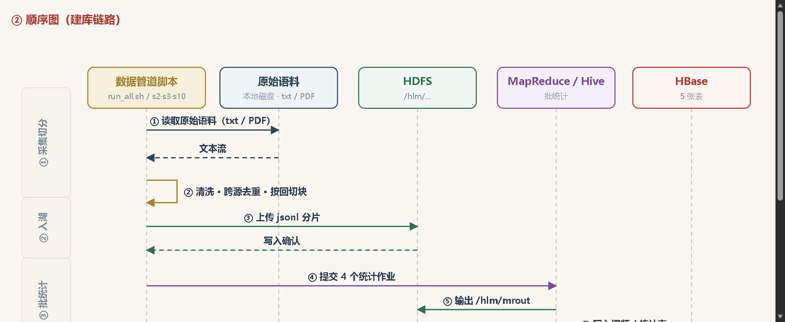
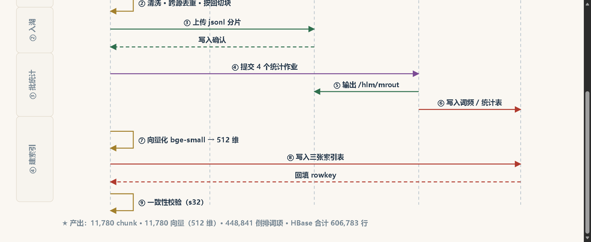

# S38 · 建库顺序图：从原始语料到存入 Hadoop 生态

> 日期：2026-10-27
> 需求：顺序图再补一张 —— 从数据获取到存入 Hadoop 生态（即建库）的链路

---

## 一、为什么要补这张

原来的顺序图只画了**线上查询链路**（用户提问 → 检索 → 生成 → 展示）。
但同学会自然产生一个疑问：**这些索引是怎么来的？**

补一张**离线建库链路**，两张图形成对照：

| 图 | 什么时候跑 | 回答的问题 |
|:---|:---|:---|
| 查询顺序图 | 每次提问 | AI 怎么把答案找出来 |
| **建库顺序图** | 建库时跑一次 | 索引是怎么攒出来的 |

关键对比：**建库只跑一次，线上问答不再碰原始文件**。

---

## 二、图的结构





### 2.1 五条生命线

```
数据管道脚本  →  原始语料  →  HDFS  →  MapReduce/Hive  →  HBase
```

| 生命线 | 说明 |
|:---|:---|
| 数据管道脚本 | `run_all.sh` / `s2_1_chunk.py` / `s3_mapreduce.py` / `s10_1_unify_pizhu.py` |
| 原始语料 | 本地磁盘：三版本正文 txt + 脂批 PDF |
| HDFS | `/hlm/warehouse` `/hlm/derived` `/hlm/mrout` `/hlm/logs` |
| MapReduce / Hive | 批统计计算 |
| HBase | 5 张表（chunks / vectors / terms / wordfreq / stats）|

### 2.2 四个阶段

```
① 采集切分   读取语料 → 清洗·跨源去重·按回切块
② 入湖       上传 jsonl 分片到 HDFS
③ 批统计     4 个 MapReduce 作业 → /hlm/mrout → 写词频/统计表
④ 建索引     向量化 → 写三张索引表 → 回填 rowkey → 一致性校验
```

### 2.3 九条消息

| # | 消息 | 方向 |
|:--|:---|:---|
| ① | 读取原始语料（txt / PDF）| 脚本 → 语料 |
| ② | 清洗 · 跨源去重 · 按回切块 | 脚本自调用 |
| ③ | 上传 jsonl 分片 | 脚本 → HDFS |
| ④ | 提交 4 个统计作业 | 脚本 → MapReduce |
| ⑤ | 输出 /hlm/mrout | MapReduce → HDFS |
| ⑥ | 写入词频 / 统计表 | MapReduce → HBase |
| ⑦ | 向量化 bge-small → 512 维 | 脚本自调用 |
| ⑧ | 写入三张索引表 | 脚本 → HBase |
| ⑨ | 回填 rowkey / 一致性校验（s32）| HBase → 脚本 / 自调用 |

### 2.4 底部产出标注

```
★ 产出：11,780 chunk · 11,780 向量（512 维）· 448,841 倒排词项 · HBase 合计 606,783 行
```

让同学一眼看到"这条链路跑完到底产生了什么"。

---

## 三、实现要点

### 3.1 与查询顺序图共用绘制风格

两张图都用了：

- 头部框（名称 + 副标题）
- 虚线生命线
- 左侧旋转文字的阶段栏
- 实线 = 调用 / 虚线 = 返回（UML 惯例）
- 自调用用回折箭头

### 3.2 标签宽度控制（重要）

跨生命线的消息标签**必须能塞进两端间距**，否则会压到相邻生命线。

5 条生命线间距：200 / 210 / 210 / 205 单位。
13.5px 中文每字约 13.5 单位 → **最多约 14 字**。

所以标签都控制在 14 字以内：

| 原始想法 | 实际用词 | 字数 |
|:---|:---|---:|
| 上传 chunks_3ver.jsonl / pizhu_3src.jsonl | 上传 jsonl 分片 | 10 |
| 输出 /hlm/mrout/* | 输出 /hlm/mrout | 12 |
| 写入 hlm_wordfreq / hlm_stats | 写入词频 / 统计表 | 9 |
| 写入 hlm_chunks / hlm_vectors / hlm_terms | 写入三张索引表 | 8 |

**这一步在第一张顺序图时没做够**，`proxy /api/*` 之类标签会压到框上，这次从一开始就按字数约束写。

### 3.3 批量渲染自检

`scripts/s37_render_diagrams.mjs` 扩展为三张图：

```
_seq_diagram.html:   8359 B, <svg>=1 </svg>=1 OK
_bseq_diagram.html: 10049 B, <svg>=1 </svg>=1 OK
_bdep_diagram.html: 13011 B, <svg>=1 </svg>=1 OK
```

同时检查 `undefined` / `NaN` 残留。

> 这个脚本是脱离 SPA 单独预览图的唯一可靠手段 ——
> 浏览器自动化直接导航到测试页时，SPA 路由会把页面拉回 `#/graph`。

---

## 四、欢迎页第 2 节的最终结构

```
2 程序架构
  ├── 先看一次提问经历了什么（顺序图）      ← 线上链路
  ├── 再看数据是怎么进去的（建库顺序图）    ← 离线链路  ★本次新增
  ├── 完整架构（同样的流程，展开到组件级）  ← 原架构图
  └── 这些东西都跑在哪（部署图）            ← 进程/容器/云
```

四段递进：**时间（查询）→ 时间（建库）→ 结构 → 物理**。

截图：`shots/69-build-seq-section.png`（页面内的标题 + 说明文字）

---

## 五、验收

| 项 | 结果 |
|:---|:---|
| 5 条生命线渲染 | ✅ |
| 4 个阶段栏 | ✅ 采集切分 / 入湖 / 批统计 / 建索引 |
| 9 条消息（含 3 个自调用）| ✅ |
| 标签不压生命线 | ✅ 全部 ≤14 字 |
| 虚线返回消息 | ✅ |
| 页面内渲染 | ✅ |
| 三张图批量自检 | ✅ 全部 OK |

---

## 六、改动文件

| 文件 | 改动 |
|:---|:---|
| `web/public/js/diagrams_simple.js` | **新增** `renderBuildSequenceDiagram()`（约 95 行）|
| `web/public/js/page_home.js` | 第 2 节插入建库顺序图 + 导入 |
| `scripts/s37_render_diagrams.mjs` | 支持三张图批量渲染 |

Git：`8425a65`，已推送 https://github.com/liuyang9851/HongLouZhiWen

---

## 七、两张顺序图的对照价值

讲课时可以这样串：

> **左边这张（建库）跑一次，右边这张（查询）跑很多次。**
> 建库阶段把书拆成 1 万多个小块、算好词频共现、转成 512 维向量，
> 全部存进 HDFS 和 HBase。
> 之后每次提问，只需要在现成的索引里找 30 个候选块 —— 所以能秒回。

这个对照把「为什么要有 Hadoop」讲清楚了：
**离线重计算 + 在线轻查询**，正是离线批处理存在的意义。

---

*本文档记录建库顺序图的实现。*
