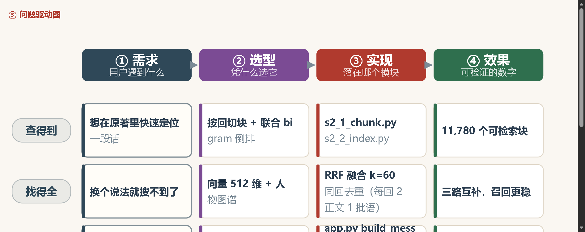

# S39 · 问题驱动图：从需求到选型到实现到效果

> 日期：2026-10-27
> 需求：设计一张基于问题驱动的图，描绘项目从需求 → 选型 → 实现 → 效果的过程

---

## 一、定位：这是「叙事图」，不是「架构图」

前面几张图都在讲**技术长什么样**（顺序图讲流程、架构图讲组件、部署图讲位置）。
这张图回答的是另一个问题：**为什么要这么做？**

| 图 | 讲的维度 |
|:---|:---|
| 问题驱动图 | **因果**：什么问题 → 什么决定 → 什么结果 |
| 查询顺序图 | 时间：一次提问怎么走 |
| 建库顺序图 | 时间：数据怎么进去 |
| 完整架构图 | 结构：由什么组成 |
| 部署图 | 物理：跑在哪 |

放在「2 程序架构」之前，读者先理解动机，再理解实现。

---

## 二、图的骨架：4 列 × 4 行



### 2.1 四列（时间轴）

```
① 需求          ② 选型           ③ 实现            ④ 效果
用户遇到什么  →  凭什么选它   →   落在哪个模块   →  可验证的数字
```

### 2.2 四行（四条因果链）

| 行标签 | ① 需求 | ② 选型 | ③ 实现 | ④ 效果 |
|:---|:---|:---|:---|:---|
| **查得到** | 想在原著里快速定位一段话 | 按回切块 + 联合 bigram 倒排 | `s2_1_chunk.py`<br>`s2_2_index.py` | 11,780 个可检索块 |
| **找得全** | 换个说法就搜不到了 | 向量 512 维 + 人物图谱 | `RRF 融合 k=60`<br>同回去重（每回 2 正文 1 批语）| 三路互补，召回更稳 |
| **答得准** | 大模型会编造「原文」 | RAG + 强制引用<br>三档知识策略 | `app.py build_messages`<br>片段编号 → 引用角标 | 每条结论都带出处<br>可点回原文段落 |
| **存得下** | 百万级索存放哪、怎么算 | HDFS 存湖 + HBase 在线<br>MapReduce 离线批算 | `s3_mapreduce.py`<br>`s10_1_unify_pizhu.py` | 606,783 行 · 副本 2<br>HDFS 550 MB / 1.97 TB |

**16 格全部填实**，没有空格 —— 这本身就是设计质量的体现：
每一行都能从问题一直追到可验证的数字。

---

## 三、三个设计决策

### 3.1 用「用户的困惑」当行标签，不用技术名词

行标签是 **查得到 / 找得全 / 答得准 / 存得下**，而不是
「索引层 / 检索层 / 生成层 / 存储层」。

这样同学第一眼看的是**自己会遇到的问题**，而不是陌生的分层术语。

### 3.2 需求列加粗描边高亮

```javascript
const card = (x, y, lines, color, emphasize = false) => `
  ${box(x, y, COL_W, cardH,
        emphasize ? '#fffdf8' : '#ffffff',
        emphasize ? color + '99' : '#dfd6c7',
        9, emphasize ? 1.9 : 1.3)}
  ...`;
// 第一列传 emphasize = true
```

视觉上把「起点」压住 —— **起点是问题，不是技术**。

### 3.3 底部两行点题

```
★ 这条链的起点不是技术，而是「读《红楼梦》时的一个具体问题」
   —— 每选一个技术，都对应一个原来答不上来的问题

需求不清就别选型，选型不清就别写代码：四个阶段一一对应，
任何一格空着都会在后面返工
```

---

## 四、页面章节顺延

插入新章节后，后续编号全部顺延：

| 编号 | 章节 |
|:---|:---|
| 1 | 关于《红楼梦》 |
| **2** | **问题驱动：为什么这么设计** ← 新增 |
| 3 | 程序架构（四张图）|
| 4 | 项目功能 |
| 5 | 技术栈 |
| 6 | 试试这些问题 |

> 顺延时踩了个小坑：原本「项目功能」和「技术栈」都标着 4，
> 第一遍替换只改了一处，导致两个 4。已修正。

---

## 五、验收

| 项 | 结果 |
|:---|:---|
| 4 列 × 4 行 = 16 格全部填充 | ✅ |
| 左侧行标签完整显示 | ✅ 列宽 92 → 118 |
| 需求列高亮 | ✅ 深色描边 + 米白底 |
| 列间箭头方向 | ✅ 需求 → 选型 → 实现 → 效果 |
| 底部说明 | ✅ 两行 |
| 页面内渲染 | ✅ |
| 四张图批量自检 | ✅ 全部 OK |

---

## 六、改动文件

| 文件 | 改动 |
|:---|:---|
| `web/public/js/diagrams_simple.js` | **新增** `renderQuestionDrivenDiagram()`（约 110 行）|
| `web/public/js/page_home.js` | 新增章节 + 导入 + 后续章节编号顺延 |
| `scripts/s37_render_diagrams.mjs` | 支持四张图批量渲染 |

Git：`b00d6ef`，已推送 https://github.com/liuyang9851/HongLouZhiWen

---

## 七、讲课时怎么用这张图

这张图适合**开场三分钟**：

> 我们不是先决定"要用 Hadoop"，才去想"用来干嘛"。
> 是从读《红楼梦》时的四个具体困惑开始的：
> 想在原文里快速找到一句话 → 所以要切块、建倒排索引；
> 换个说法就搜不到了 → 所以要向量和图谱，三路互补；
> 大模型会一本正经地编造"原文" → 所以要 RAG，每条结论强制标出处；
> 百万级索引又要存又要算 → 所以才有 HDFS 和 HBase。
> **四个问题，逼出了整个技术栈。**

讲完这张图，再放顺序图和架构图，同学就有"为什么"的底子了。

---

*本文档记录问题驱动图的设计与实现。*
